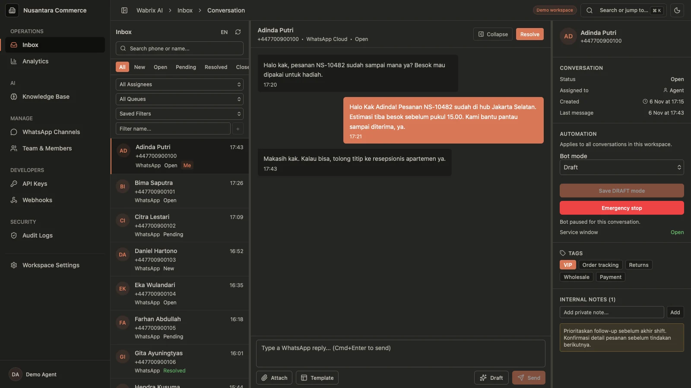
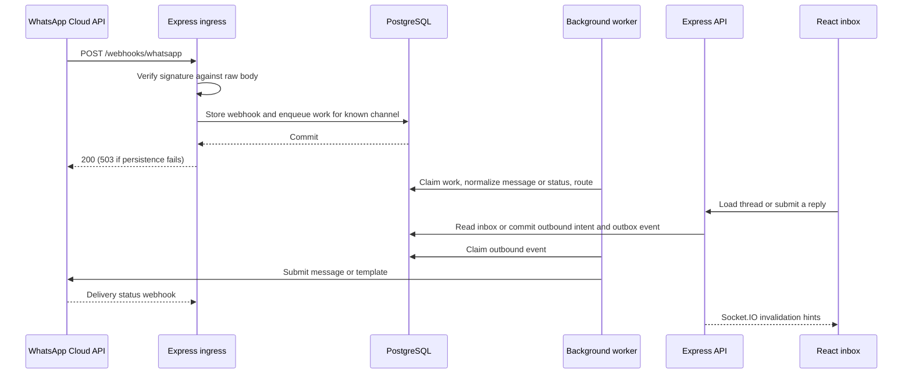

# Wabrix AI

**A shared WhatsApp inbox with AI-assisted replies, backed by a durable PostgreSQL message pipeline.**

Support teams can connect WhatsApp Business numbers, route incoming conversations to queues and agents, and draft replies from their workspace knowledge base. The backend verifies and stores incoming webhooks before acknowledging them, then lets workers handle normalization, routing, AI, and delivery.

[Product preview](#product-preview) · [Architecture](#architecture) · [Run locally](#run-locally) · [Testing](#testing)

This repository contains the **React, Express, and PostgreSQL implementation**, previously named FlowDesk AI. The [original Wabrix repository](https://github.com/ryanakml/wabrix) addresses the same product problem with a separate Next.js, Convex, Clerk, and Cloudflare Workers implementation.

## Product workflows

| Workflow            | What the application supports                                                                                                                                           |
| ------------------- | ----------------------------------------------------------------------------------------------------------------------------------------------------------------------- |
| Connect WhatsApp    | Connect a WhatsApp Business Account through Meta Embedded Signup when configured, or enter credentials manually. Manage channels and sync approved templates.           |
| Triage and reply    | Work from a live inbox with queues, assignments, tags, internal notes, and delivery status. Use approved templates when the WhatsApp service window has closed.         |
| Assist with AI      | Ingest knowledge sources, retrieve relevant chunks, and review or edit drafted replies. Optional automatic replies depend on workspace policy and runtime safety gates. |
| Operate a workspace | Invite teammates, assign roles, review audit activity, and inspect conversation, SLA, and workload analytics.                                                           |
| Integrate           | Create scoped API keys and subscribe to signed developer webhooks.                                                                                                      |

## Product preview



_Local capture of the React UI using a mock API and synthetic conversations. The [original Wabrix site](https://wabrix.nylo.me/) is a separate application._

## Architecture

Wabrix AI is a [modular monolith with separate process roles](docs/adr/001-modular-monolith-process-roles.md). The web app, REST API, webhook ingress, worker, and scheduler live in a pnpm/Turborepo workspace. PostgreSQL stores application state and durable work.



### Webhook reliability and message delivery

- **Durable intake.** [Ingress](apps/ingress/src/app.ts) validates Meta's HMAC-SHA256 signature before parsing the body. With PostgreSQL configured, [persistence](packages/db/src/webhooks.ts) deduplicates by provider and SHA-256 hash of the raw body. A new event for a known channel and its outbox entry are committed together. The request returns HTTP 503 if persistence fails so Meta can retry.
- **Transactional outbox.** The API records outbound intent and enqueues work in PostgreSQL in the same transaction. Workers claim batches with `FOR UPDATE SKIP LOCKED`, apply bounded retries and backoff, and dead-letter terminal failures. Ingress deduplication and outbound idempotency keys protect different boundaries; a network timeout at the provider is still ambiguous. See the [outbox and recovery runbook](docs/runbooks/whatsapp-outbox-dlq.md) and [vertical slice integration tests](apps/worker/src/vertical-slice.integration.test.ts).
- **Delivery and realtime state.** The worker dispatches WhatsApp text, templates, or media. Status webhooks flow through the same ingress and update stored message state. The API uses Socket.IO to signal clients to refetch inbox data; Redis can relay those signals between API instances.

### AI, media, and tenant operations

- **Knowledge and AI.** Ingestion jobs extract and chunk source content, call a Gemini or OpenAI embedding adapter, and store vectors in pgvector. The draft worker retrieves relevant chunks and adds them to the conversation prompt. [Automatic sending](apps/worker/src/auto-send.ts) checks confidence, the WhatsApp service window, safety policy, budget and rate limits, and whether a human has already taken over.
- **Two Redis roles.** Redis backs Socket.IO broadcasts across API instances. An independent, opt-in [query embedding cache](docs/runbooks/query-embedding-cache.md) uses tenant-scoped keys and falls back to the embedding provider on cache failures. PostgreSQL owns durable work in both cases.
- **Media.** Attachments use an S3-compatible store, with [quarantine and ClamAV scanning](docs/runbooks/media-quarantine.md) before access and retention cleanup afterward.
- **Tenant operations.** OIDC sessions, workspace roles, and [PostgreSQL row-level security](docs/adr/002-postgresql-rls-tenant-boundary.md) enforce access. The scheduler aggregates analytics per tenant. The worker delivers signed developer webhooks with retry and dead-letter handling.

## Stack and repository layout

| Area                  | Code and tools                                                                                                                                                                                                                                                     |
| --------------------- | ------------------------------------------------------------------------------------------------------------------------------------------------------------------------------------------------------------------------------------------------------------------ |
| Web                   | [`apps/web`](apps/web) — React 19, Vite, TanStack Router/Query/Table, Tailwind CSS, Radix UI, Recharts                                                                                                                                                             |
| HTTP                  | [`apps/api`](apps/api) and [`apps/ingress`](apps/ingress) — Node.js 22, strict TypeScript, Express 5, Zod, OIDC sessions, Socket.IO                                                                                                                                |
| Background processing | [`apps/worker`](apps/worker) for durable jobs; [`apps/scheduler`](apps/scheduler) for periodic analytics aggregation                                                                                                                                               |
| Data and contracts    | [`packages/db`](packages/db) — PostgreSQL 16, pgvector, `pg` queries and SQL migrations; Prisma schema for data modeling. [`packages/contracts`](packages/contracts) contains Zod schemas and the OpenAPI generator.                                               |
| Shared packages       | [`packages`](packages) — domain policies, WhatsApp/AI/storage provider adapters, security, configuration, observability, shared UI, and test fixtures                                                                                                              |
| Local infrastructure  | [`infra/compose`](infra/compose) — Docker Compose, Redis, MinIO, ClamAV, Mailpit, OpenTelemetry Collector, Prometheus and Grafana; application logs use pino                                                                                                       |
| Deployment reference  | [`infra/docker`](infra/docker), [`infra/deploy`](infra/deploy), and [`infra/terraform`](infra/terraform) — service images, a [single-host Compose staging runbook](docs/runbooks/single-host-staging.md), and AWS/ECS reference infrastructure and release tooling |

The repository retains `@flowdesk/*` package names, the `flowdesk` database schema, and existing integration identifiers for compatibility.

## Run locally

Requires **Node.js 22** (see `.nvmrc`), **pnpm 10**, **Docker with Compose v2**, and **Make**.

```bash
git clone https://github.com/ryanakml/wabrix-ai.git
cd wabrix-ai
nvm use
make bootstrap
make compose-up
make db-migrate
make dev
```

`make bootstrap` installs from the lockfile and copies [`.env.example`](.env.example) to `.env` if needed. Wait for local PostgreSQL to become healthy before migrating. The sample environment enables local mock sign-in and mock AI. Real OIDC, WhatsApp, and AI provider calls require their own credentials and settings; see the [configuration guide](docs/delivery/CONFIGURATION.md) and [Meta signup runbook](docs/runbooks/meta-embedded-signup.md).

| Service                      | Default local address                                |
| ---------------------------- | ---------------------------------------------------- |
| Web, API, ingress            | `localhost:3000`, `localhost:4000`, `localhost:4001` |
| Worker and scheduler health  | `localhost:4002`, `localhost:4003`                   |
| PostgreSQL and Redis         | `localhost:5433`, `localhost:6379`                   |
| MinIO API and console        | `localhost:9000`, `localhost:9001`                   |
| Mailpit, Prometheus, Grafana | `localhost:8025`, `localhost:9090`, `localhost:3001` |

Use `make compose-down` to stop local services. Use `make db-reset` only for disposable local data; it wipes and recreates the local database volume. See the [migration runbook](docs/runbooks/database-migrations.md).

## Testing

```bash
make verify                          # format, OpenAPI drift, lint, types, tests, and build
pnpm --filter @flowdesk/web test      # web component and route tests
pnpm --filter @flowdesk/web test:e2e  # Playwright browser tests (install a browser first)
```

Vitest covers signature validation, webhook deduplication, routing, delivery retries, tenant isolation, and AI policy. PostgreSQL and Redis integration cases require the corresponding test services and environment variables; see the [testing guide](docs/delivery/TESTING.md) and [CI configuration](.github/workflows/ci.yml). See [contributing](CONTRIBUTING.md) and the [OpenAPI specification](docs/api/openapi.json) for developer workflow and API details.
